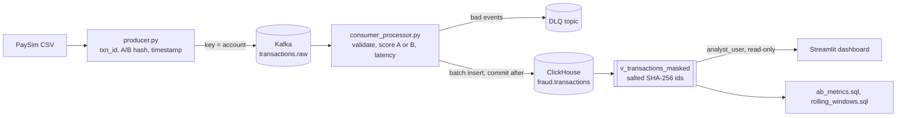

# Real-Time Fraud Detection A/B Engine

Streams card/mobile-money transactions through **Kafka**, scores each one with one of two fraud rule sets chosen by a
deterministic user-level A/B split, stores results in **ClickHouse** behind a PII-masked, role-restricted analyst view, and
reports which rule is better (detection rate, false positives, latency SLA, statistical significance) in a **Streamlit** dashboard.

**Business question:** *Does a behavioural rule (account-drain + mule-account velocity) catch more fraud than the static
amount-threshold rule, without blocking more good customers? And is the difference statistically real?*

## Demo results (200k synthetic PaySim-format rows)

| | Rule A: static threshold (control) | Rule B: drain + velocity (treatment) |
|---|---|---|
| Users / transactions | 99,426 txns | 100,574 txns |
| Fraud detection rate (recall) | 37.7% | **91.8%** |
| False-positive rate | 0.502% | **0.097%** |
| Precision | 25.9% | **81.9%** |
| Fraud amount missed | 23.1M | **4.4M** |

Difference in detection rate: **+54.1 pp (95% CI +49.0 to +59.1, p < 0.0001)**. The sample-ratio check confirms the split is 50/50.

> These numbers come from a **synthetic** file built to resemble PaySim (`scripts/generate_sample_data.py`), so the gap is
> exaggerated. Run the pipeline on the real PaySim CSV and quote *those* numbers on your resume.

## Architecture



## Quick start

**Option 1: no Docker, 2 minutes (demo mode)**
```bash
pip install -r requirements-dev.txt
make demo            # generates sample data, scores it, opens the dashboard
make test            # 21 tests incl. the SQL files run on an embedded ClickHouse
```

**Option 2: full stack (Kafka + ClickHouse)**
```bash
make env             # creates .env with random secrets
make up              # Kafka, ClickHouse, topics, tables, masking view, roles
make app             # consumer + dashboard containers  ->  http://localhost:8501
make produce         # streams data/sample_paysim.csv into Kafka
```
For the real dataset, put the PaySim CSV in `data/` and pass `--source` to the producer.

## Repository structure

```
├── .github/workflows/ci-cd.yml      lint, tests, pip-audit, secret-file check, docker build, push to GHCR
├── config/
│   ├── kafka_config.yaml            topics, partitions, retention, client tuning (single source for topic creation)
│   └── clickhouse_config.xml        settings profiles: query limits per role
├── docker/                          docker-compose.yml, Dockerfile (non-root), clickhouse-init.sql
├── pipeline/
│   ├── settings.py                  env-based config, no secrets in code
│   ├── logging_config.py            JSON logs, rotating file, account-id redaction
│   ├── hashing.py                   sticky 50/50 routing + salted SHA-256 masking
│   ├── rules.py / scoring.py        Rule A, Rule B, velocity tracker, validation
│   ├── ab_stats.py                  z-test, confidence interval, sample-ratio-mismatch check
│   ├── producer.py                  CSV -> Kafka (chunked, throttled, idempotent)
│   └── consumer_processor.py        Kafka -> score -> ClickHouse (DLQ, retries, commit after insert)
├── database/
│   ├── schemas/01_table_transactions.sql, 02_view_pii_masking.sql
│   ├── security/03_rbac_setup.sql   roles, users, grants, quota
│   └── queries/ab_metrics.sql, rolling_windows.sql
├── dashboard/                       app.py, components.py, data_access.py (live + demo backends)
├── scripts/                         init_db.py, create_topics.py, generate_sample_data.py, run_local_demo.py, make_env.py
├── tests/                           routing, masking, rules, stats, SQL integration
└── docs/                            SECURITY.md, DEPLOYMENT.md
```
(`pipeline/__init__.py` is the package marker you listed as `init.py`.)

## How the A/B test works

- **Routing:** `SHA-256(experiment_salt:user_id) mod 100 < 50` gives variant A, otherwise B. It is sticky (a user never switches),
  needs no lookup table, and the consumer recomputes it so a tampered `variant` field is never trusted.
- **Metrics:** detection rate = TP / actual fraud; false-positive rate = FP / legitimate; precision; fraud amount caught/missed;
  latency p50/p95/p99 and % within the SLA (default 100 ms).
- **Statistics:** two-proportion z-test with 95% CI for detection and false-positive rates, plus a chi-square
  sample-ratio check that flags routing bugs before you trust results.
- **Velocity attacks:** `rolling_windows.sql` uses a 6-hour `RANGE` window per destination account to find mule accounts.

## Security (details in docs/SECURITY.md)

- Analysts query only `v_transactions_masked`: account ids appear as salted SHA-256 hashes; no grant on the base table.
- Least-privilege roles: `pipeline_role` (insert/select), `analyst_role` (view only); read-only profile, memory/time/row limits, hourly quota.
- Secrets only in `.env` (git-ignored); app refuses to initialise with placeholder secrets; CI fails if a `.env` or key file is tracked.
- Logs redact account ids; containers run as non-root; Kafka and ClickHouse ports bind to localhost.

## Reliability and observability

At-least-once delivery (commit after insert) with `ReplacingMergeTree` dedup, dead-letter topic for bad events, insert retries with
backoff, graceful shutdown, structured JSON logs in `logs/pipeline.log`, idempotent producer (`acks=all`).

## What was and was not verified

Verified here: all 21 tests pass, including the three SQL files executing on an embedded ClickHouse engine and matching the
Python logic; dashboard loads in demo mode; configs parse. **Not executed here:** the Docker stack, Kafka broker and
role/permission enforcement (no Docker in the build environment). Run `make up` and `make produce` once and fix any local
environment differences before presenting it. ClickHouse 24.8 is pinned for `SQL SECURITY DEFINER` views.


## Analysis and hardening additions

- `notebooks/01_eda_paysim.ipynb`: exploratory analysis starter for real PaySim data.
- `docs/DATA_DICTIONARY.md`, `docs/FINDINGS.md`, `data/README.md`: data and reproducibility documentation.
- `docs/PRODUCTION_READINESS.md`: production deployment gates and known limitations.
- `pipeline.ab_stats.cluster_bootstrap_rate_difference`: exploratory user-cluster bootstrap for fraud recall; do not use transaction-level p-values as final inference.
- Logging redaction now covers formatted messages, nested context and exception text. HMAC-SHA256 pseudonyms are configured in Python and the ClickHouse view; ClickHouse has no HMAC function, so the view rebuilds HMAC-SHA256 from SHA256 and two key pads (see `pipeline/hashing.py`).

**Important:** this is still not production-certified. The destination velocity feature is in-memory and not safe for horizontal scaling/restarts; the current DLQ contains raw payloads with account identifiers. See `docs/PRODUCTION_READINESS.md` and do not connect it to real payment traffic until those blockers are resolved.
